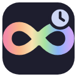
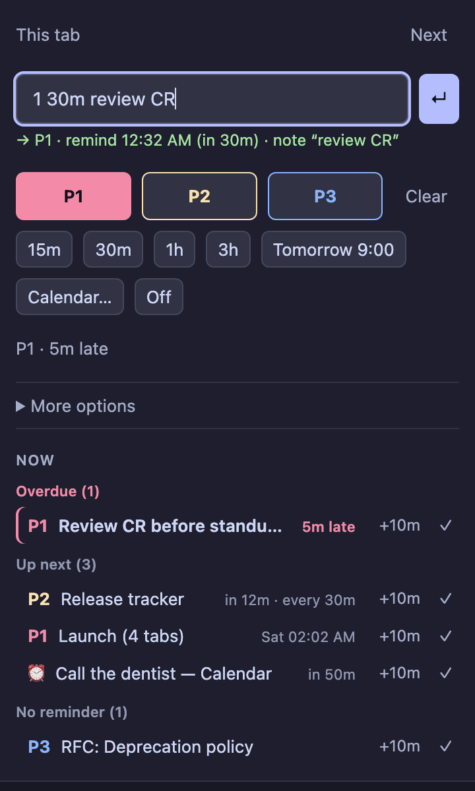
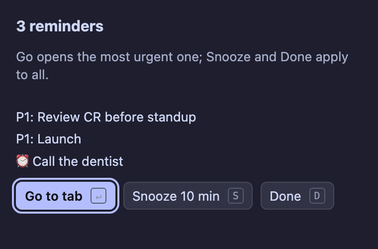

<p align="center"></p>

<h1 align="center">Timetabs</h1>

<p align="center">
  <a href="../../actions/workflows/ci.yml"></a>
  
  
  
</p>

**Reminders for time-blind brains.** Mark the tabs that matter and get nudged back before you forget them.

Built for neurodivergent brains — the ones that keep twenty tabs open and lose track of the one that mattered: one shortcut and a few typed words do everything, reminders keep coming until you deal with them, and the toolbar icon tells you when something is overdue.

<p align="center">
  
  &nbsp;
  
</p>

## What it does

- **Priorities.** Mark tabs P1, P2 or P3. Marked tabs can be collected into colored P1/P2/P3 tab groups, or left exactly where they are.
- **Reminders.** "In 15 minutes", "tomorrow at 9", "every 30 minutes", or type any time: `15:30`, `45m`, `fri 9`.
- **Groups.** Name a set of tabs ("Launch") and give the whole group one reminder.
- **Overdue badge.** A red count on the toolbar icon shows reminders you haven't acted on. Visiting the tab clears it.
- **Now list.** Overdue, up next and unscheduled tabs, with one-click snooze and done.
- **Alerts that reach you.** System notifications, or a small pop-up window if macOS is blocking Chrome's notifications — with a chime that gets more insistent for higher priorities (P1 three notes, P2 two, P3 one, plain reminders a soft ding-dong).

## Install

**From source** (Chrome, Edge, Brave, Arc — any Chromium browser):

1. Clone this repository.
2. Open `chrome://extensions` and turn on **Developer mode**.
3. Click **Load unpacked** and choose the **`src/`** folder.
4. Pin it: puzzle-piece icon → pin next to Timetabs.

**From a release:** download `timetabs-<version>.zip` from the CI artifacts or Releases, unzip it, and load that folder the same way.

## Use

Press **⌥⇧P** and type what you mean, then **↵**:

| Type | Does |
|---|---|
| `1` `2` `3` (or `p1`…) | Set priority |
| `30m` `2h` `15:30` `3pm` `tomorrow 10` `fri 9` | Remind once — without a priority it's a plain ⏰ reminder that disappears once you've seen it |
| `every 30m` | Remind repeatedly |
| `1 30m review CR` | All at once — words after the priority and time become the note |
| `done` / `x` · `off` · `snooze [15m]` · `next` | Clear · reminder off · snooze · jump to most urgent |

The line under the box shows what it understood before you press Enter. Buttons do the same for the mouse.

| Where | Keys |
|---|---|
| Anywhere | **⌥⇧P** command bar · **⌥⇧N** jump to most urgent · **⌥⇧S** snooze everything overdue · **⌥⇧1** mark P1 |
| In the popup | **↓** into the list · **↑↓** move · **↵** go · **S** snooze · **D** done |
| Right-click a page or the toolbar icon | **Timetabs** menu with the same actions |

Chrome allows only four default shortcuts; mark P2/P3 and clear can be assigned at `chrome://extensions/shortcuts`.

## macOS notes

- **Sticky alerts** (P1 and one-off reminders) only stay on screen if Chrome's style is **Alerts** in System Settings → Notifications → Google Chrome; with **Banners** they slide away after a few seconds.
- **Snooze / Done** buttons on system notifications sit behind the notification's **Options** menu.
- If notifications don't show up at all, switch **More options → Alerts** to **Pop-up window**: it doesn't depend on macOS permissions.
- Reminders that fire together (e.g. a reminder set on 5 selected tabs) arrive as **one** alert and one chime.

## Development

No dependencies, no build step: `src/` is the extension as Chrome loads it. You need Node 20+ only for the checks.

```bash
npm run check     # verify + test
npm run verify    # every path in the manifest, pages and code resolves; shortcut and description limits
npm test          # unit and integration tests (Node's built-in runner)
npm run package   # dist/timetabs-<version>.zip for the Chrome Web Store
```

After editing, click **↻** on the extension card in `chrome://extensions`: pages reload on their own, the background worker doesn't.

`tests/fake-chrome.js` stands in for the extension APIs. Its storage resolves after a random delay and its events don't await listeners — like Chrome — so concurrency bugs show up in tests rather than in your browser.

### Project structure

```
src/                     the extension — load this folder in Chrome
├── manifest.json
├── background.js        service worker: marks, alarms, alerts, shortcuts, menus
├── shared.js            helpers shared by the worker and every page (time parsing, command bar grammar)
├── styles.css           design tokens (Catppuccin Mocha)
├── popup/               command bar, quick actions, Now list
├── alert/               pop-up reminder window
├── welcome/             first-run page
├── offscreen/           plays chimes (workers can't play audio)
└── icons/
tests/                   node:test suites and the fake Chrome API
scripts/                 verify.js (reference checker), package.sh (zip for the store)
assets/logo.svg          source artwork for the icons
docs/                    screenshots
```

### Releasing

1. Bump `version` in both `src/manifest.json` and `package.json` (`npm run verify` fails if they differ).
2. Add an entry to [CHANGELOG.md](CHANGELOG.md).
3. `npm run package` and upload the zip.

## Privacy

See [PRIVACY.md](PRIVACY.md). In short: everything stays in your browser. Marks are kept in session storage and cleared when Chrome restarts; settings are kept locally. No network requests, no analytics.

| Permission | Why |
|---|---|
| `tabs`, `tabGroups` | Read tab titles, focus tabs, create and color groups |
| `alarms`, `notifications` | Schedule and show reminders |
| `offscreen` | Play the reminder chime (background workers can't play audio) |
| `storage` | Remember marks and settings |
| `contextMenus` | The right-click menu |

## License

[MIT](LICENSE)
